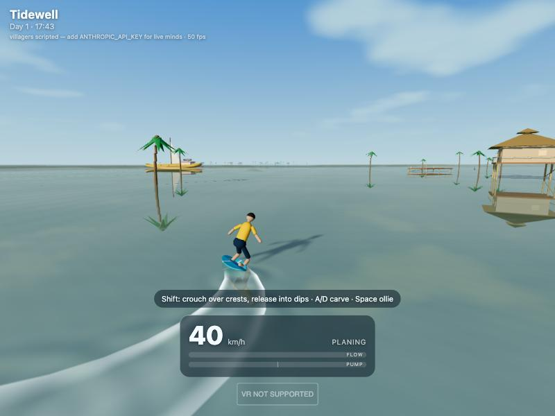
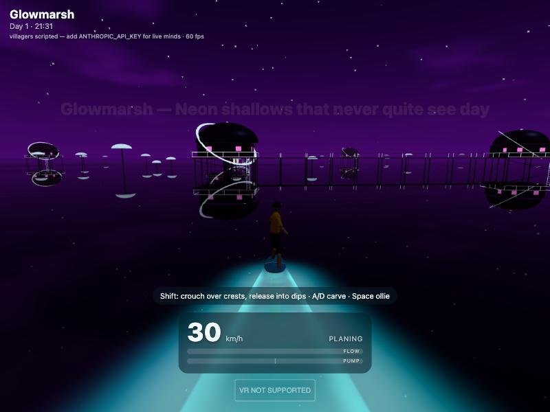
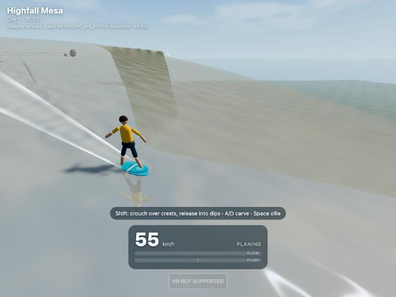
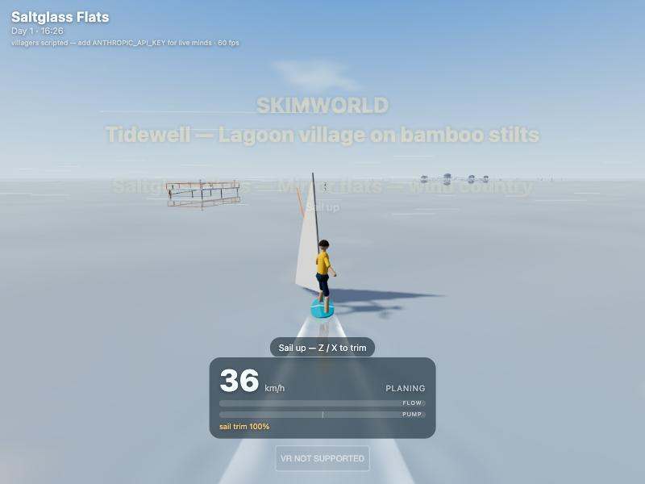
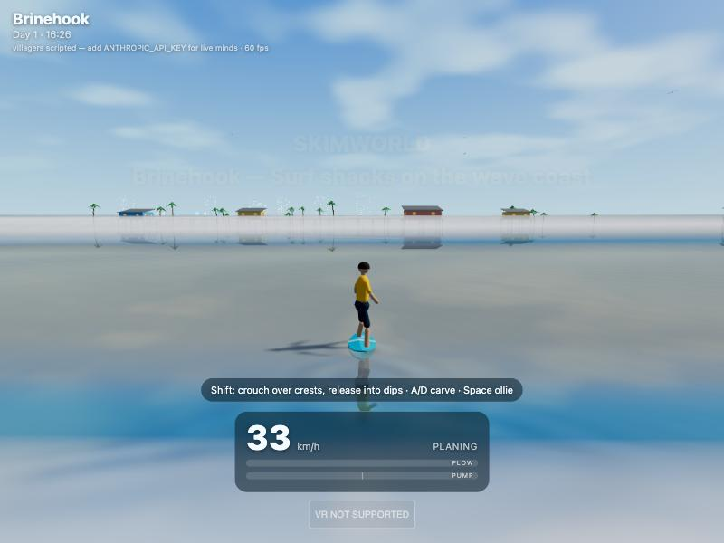
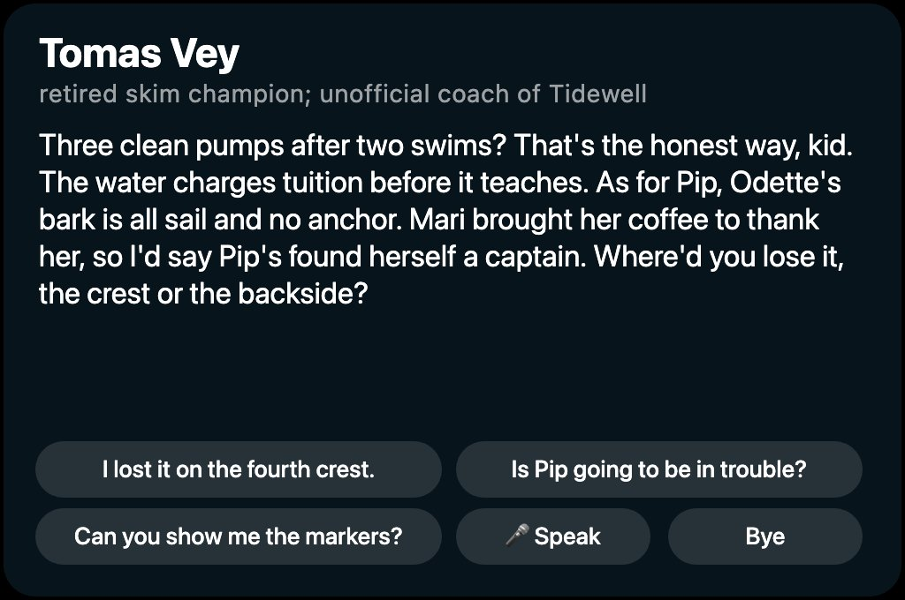

# Skimworld

A skimboarding world for **Meta Quest 3** (WebXR — runs in the Quest Browser, no store install), also playable on desktop.

Everywhere is covered in a thin film of water. You get around by skimboarding: run, throw your board ahead, hop onto it as it slides, and plane across the mirror. Five stilt villages with their own vibes, waves, wind, waterfalls, thermals, giant skimboats — and 14 villagers whose minds run on Claude.



| | |
|---|---|
|  |  |
|  |  |

**Play it:** https://skimworld.vercel.app (open it in the Quest Browser and press **Enter VR**).

## Run it

```bash
npm install
npm run dev          # game on :5173, villager server on :8787
```

Open http://localhost:5173 on desktop.

**Live villager minds:** export `ANTHROPIC_API_KEY` (or run `ant auth login`) before `npm run dev`. If the key is in `~/.zshrc`, launch from an interactive shell (`zsh -ic 'npm run dev'`); `.claude/launch.json` already does this. Without credentials the villagers fall back to scripted lines and the world still works. Model defaults to `claude-opus-5-5`; override with `NPC_MODEL` / `LIFE_MODEL`.

**On Quest 3** (WebXR needs a secure context):

- USB: `adb reverse tcp:5173 tcp:5173`, then open `http://localhost:5173` in the Quest Browser, or
- Wi-Fi: `npm run dev:https`, open `https://<your-mac-lan-ip>:5173`, accept the self-signed cert.

Press **Enter VR**.

## Hosting (Vercel)

The live site is the Vercel project `skimworld` on the **miles-wiesenthals-projects** (Pro) team.

- The built game is served statically from `dist/`. Every `/api/*` request is rewritten to one function, `api/index.ts`, which runs the same handler as the local server (`server/api.ts`).
- Villager memory lives in a private Vercel Blob store, `skimworld-memory`: each request loads it and writes it back. Locally it stays in `server/data/memory.json`.
- `ANTHROPIC_API_KEY` is a sensitive production env var. Spend guards: `SKIM_DAILY_CALLS` (default 400 Claude calls per UTC day, then scripted lines) and `SKIM_TICK_MINUTES` (default 10, the minimum real time between life ticks).
- `/api/world/reset` is refused on Vercel unless the request carries the `x-skim-admin` header matching `SKIM_ADMIN_TOKEN` (not set, so reset is off).

Deploy with:

```bash
vercel deploy --prod
```

## The riding (the point of the whole thing)

The skimboard physics (`src/game/skimmer.ts`) is shared by you and every villager:

- **The drop.** Run, throw the board just ahead (it leaves your hands slightly slower than you run), then **hop before you reach it** so you land on it mid-slide: *PERFECT DROP*, +20% speed and Flow. Run onto it without hopping and you lose speed.
- **Planing vs. bogging.** Above ~1.5 m/s on the film (3.6 m/s over deep water) the board planes; below it bogs and stops. Deep lagoons sink you if you're slow.
- **Pumping.** Compress over crests and extend down the back sides. The Tidewell roller ring is a pump track; timed right you gain speed, mistimed you lose it. The PUMP meter shows the live effect.
- **Carving.** Lean to turn; the rail grips and throws spray. Crouch to carve tighter. Turn harder than the grip and you skid and scrub speed.
- **Air.** Ollie (crouch first to charge), launch off kickers, wave lips, chute lips and cliffs. Spin in the air; land aligned (or switch) and **absorb the landing** to stomp it. Land sideways and you wipe out.
- **Flow.** Chaining clean drops, pumps, stomps and tricks builds Flow, which lowers drag and swells the music.

**Zones:** Brinehook's rolling waves (catch the faces), Saltglass's 14 m/s wind (get a sail at June's Sail Loft; trim it), Highfall's chutes and waterfalls (take the Mist Lift up, ride the chute down at 50+ km/h, or get a glide wing from Sora and ride the thermals), and Glowmarsh, where the water glows where you cut it.

**Skimboats:** *The Long Glide* and *Wavecutter* are giant skimboards running trade loops. Skim into one to hop aboard; run off the deck with your board for a boat drop.

## Controls

| | Quest 3 | Desktop |
|---|---|---|
| Run | swing your arms (or left stick) | W |
| Throw board / kick out / pick up | right trigger | E |
| Hop on / ollie | A, or really hop | Space |
| Pump / charge / absorb | really crouch | Shift (hold) |
| Carve | lean your body (left stick X assists) | A / D |
| Spin in the air | right stick X | ← → |
| Sail up / trim | X / aim it with your left hand | F / Z X |
| Glide wing | both grips or arms spread; raise or lower your hands to pitch | G, W/S pitch |
| Talk | B, then point and trigger a reply (or Speak) | T, type |
| Snap turn | right stick (on foot) | drag to orbit |

Desktop extras: `1`–`5` fast-travel, `R` respawn, `[ ]` shift time, `M` mute, `H` help.

## The villagers

14 people across five villages (`shared/npcs.ts`): Tomas the retired champion, Mari the board shaper and her daughter Pip, Felix of the Stilt Cup café, June the sailmaker and Ren the turbine engineer, Kip, Nalu and Dr. Ama in Brinehook, Sora and Hollis on Highfall, Vex at the Lumen Club, and the two skimboat captains Bao and Odette. Each has a personality, backstory, goals, a secret, relationships and a daily schedule. They physically ride, work on their decks, and captain their boats on that schedule.

`server/brain.ts`:

- **Conversation:** each reply is in character and knows the time, what they're doing, recent events in their life, gossip from friends, what they remember about you, how they feel about you, and what they just saw you do. Replies are spoken aloud with each villager's voice settings.
- **Lives:** every 6 in-game hours (1 in-game hour = 1 real minute) Claude advances all 14 lives by one event each, continuing their arcs (romances, rivalries, money trouble, an injury, a failing spring, the coming Regatta). Events show up on each village's notice board and in later conversations.
- **Memory** persists in `server/data/memory.json`, including the world clock, so a new session resumes on the day the villagers last lived through.



## Layout

```
shared/   world.ts (terrain, film, waves, wind, thermals), villages.ts, npcs.ts, noise.ts
src/game  skimmer.ts (physics), game.ts (loop, VR rig, feedback), npcs.ts, boats.ts, input.ts
src/render ground.ts (film shader), sky.ts, villages.ts, models.ts, effects.ts
src/ui    hud.ts, dialog.ts, panel.ts       src/audio/audio.ts (procedural sound)
server/   index.ts, brain.ts (Claude), memory.ts
tests/    physics.test.ts
```

`npm test` runs the physics tests; `npm run build` builds the static game into `dist/` (`npm start` serves it plus the villager server on one port).

## License

MIT, see [LICENSE](LICENSE).
